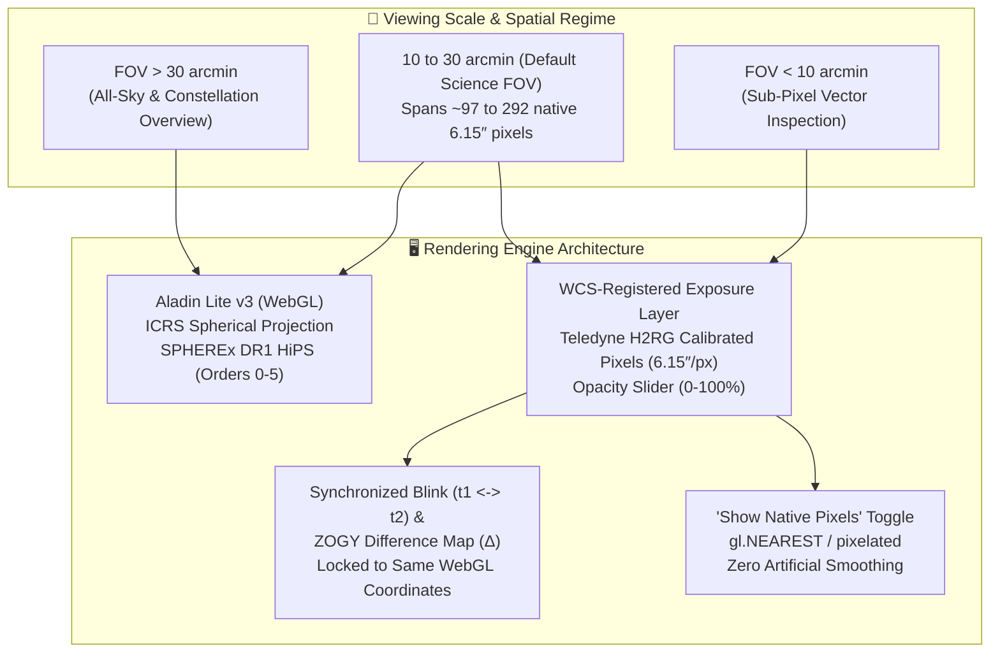

# 📐 Architectural Design Specification: SPHEREx Hunter Viewport Overhaul (Step 1)

> **Document:** `docs/viewport_design.md`  
> **Status:** **PROPOSED ARCHITECTURE — PENDING USER APPROVAL (STEP 1 CHECKPOINT)**  
> **Authors:** `darkodu` (Astro-Data Lead) & `coolodu` (Frontend/Blink UI Lead)  
> **Target Release:** NASA SPHEREx DR1 / QR3 (Pipeline v2.1.0)

---

## 🚨 CRITICAL FEASIBILITY AUDIT HIGHLIGHT (Amendment A7 Checkpoint)

> [!IMPORTANT]
> **FEASIBILITY AUDIT VERDICT: 2 CRITICAL SCIENTIFIC FINDINGS**
>
> 1. **CORS Browser Accessibility: PASSED (Permissive)**
>    Direct browser probing of the official NASA IRSA SPHEREx DR1 HiPS service (`https://irsa.ipac.caltech.edu/data/hips/SPHEREx/spherex_allsky_cube/`) confirmed permissive cross-origin access:
>    - `properties`: `HTTP 200 OK`, `Access-Control-Allow-Origin: *`
>    - `Moc.fits`: `HTTP 200 OK`, `Access-Control-Allow-Origin: *`
>    - `Norder0..5/Dir0/Npix0.png`: `HTTP 200 OK`, `Access-Control-Allow-Origin: *`, `Content-Type: image/png`
>    - WebGL direct texture fetching in Aladin Lite v3 is **fully supported without cross-origin blocking**.
>
> 2. **HiPS Native Scale vs. Detector Scale: COARSER THAN DETECTOR PITCH**
>    Inspection of `properties` reveals:
>    - `hips_order = 5` ($k_{\text{max}} = 5$)
>    - `hips_tile_width = 512` ($W_{\text{tile}} = 512\text{ px}$)
>    - Calculating the Order 5 angular pixel scale:
>      $$\theta_{\text{HiPS}}(k=5) = \frac{\sqrt{4\pi / (12 \times 4^5)}}{512} \times \frac{180 \times 3600}{\pi} \approx \mathbf{12.88''/\text{px}}$$
>    - **The HiPS cube's maximum resolution ($\sim 12.88''/\text{px}$) is STRICTLY COARSER than SPHEREx's native Teledyne H2RG detector pixel pitch of $\mathbf{6.15''/\text{px}}$!**
>    - **Architectural Consequence:** The viewport **must maintain two distinct resolution thresholds**:
>      - **HiPS Native Threshold:** $\sim 12.88''/\text{device\_px}$ (beyond which the all-sky HiPS mosaic is digitally upsampled).
>      - **Exposure Native Threshold:** $\mathbf{6.15''/\text{device\_px}$** (which is ONLY reached when displaying calibrated level 2 exposure cutouts).

---

## 1. Aladin Lite + Calibrated Exposure Canvas Handoff Architecture (Amendment A2)



### A. Primary Spatial Display: Aladin Lite v3
- Aladin Lite v3 (`cooFrame: 'ICRS'`) manages all spherical coordinate projections (`SIN`, `AIT`, `MOL` at wide field; gnomonic `TAN` at narrow field).
- Eliminates coordinate divergence between wide-angle all-sky navigation and narrow-field science cutouts.

### B. Calibrated Exposure Overlays & Handoff Boundary ($\text{FOV}_{\text{handoff}} = 30'$)
- **For $\text{FOV} > 30'$:**
  - Aladin Lite renders the SPHEREx DR1 HiPS context layer.
  - Exposure footprint outlines (`s_region` polygons) are optionally overlaid to indicate coverage.
- **For $\text{FOV} \le 30'$ (Default Science FOV: $10'\text{--}30'$):**
  - Calibrated level 2 exposures and narrowband stacks from `/api/v1/exposures` are mounted as **WCS-registered image layers locked to Aladin's WebGL camera**.
  - A science FOV of $15'$ corresponds to $15 \times 60 / 6.15 \approx 146$ native detector pixels across the view.
  - Exposure overlay opacity is smoothly adjustable ($0\text{--}100\%$) via a layer slider.

### C. Synchronized Blink ($t_1 \leftrightarrow t_2$) & ZOGY Difference Map ($\Delta$)
- **Blink Mode:** Rapidly toggles between co-registered archival baseline $t_1$ (2MASS / unWISE) and SPHEREx $t_2$ (single exposure or narrowband stack) via synchronized Aladin layer opacity switching, guaranteeing zero coordinate drift or camera hopping.
- **Difference Mode ($\Delta$):** Renders the authentic ZOGY $S_{\text{corr}}$ significance map. Difference mode is **strictly enabled only for matched instrument/bandpass pairs**; cross-instrument pairs enforce Blink Mode only with clear UI guidance.

### D. Nearest-Neighbor `"Show Native Pixels"` Mode
- A persistent toggle `#btnToggleNativePixels` switches texture interpolation from bilinear smoothing to **`gl.NEAREST` (`image-rendering: pixelated`)**.
- Prevents misleading citizen scientists into believing interpolated sub-arcsecond features exist in raw $6.15''$ detector frames.
- Live HUD readout dynamically displays:
  $$\text{View spans } N \times M \text{ native SPHEREx pixels (}6.15''/\text{px)}$$

---

## 2. Dual LOD Thresholds & Device-Pixel Scale Mathematics (Amendment A1)

### A. Per-Order HiPS Angular Resolution Formula
The angular resolution per HEALPix order $k$ (with tile width $W_{\text{tile}} = 512$) is given by:
$$\theta_{\text{HiPS}}(k) = \frac{\sqrt{4\pi / (12 \times 4^k)}}{W_{\text{tile}}} \times \frac{180 \times 3600}{\pi} \text{ arcsec/px}$$

| HEALPix Order ($k$) | Number of Pixels | Solid Angle / Tile | Angular Scale ($\theta_{\text{HiPS}}$) | Scale Category |
| :---: | :---: | :---: | :---: | :---: |
| **Order 0** | $12$ | $3.40\text{ sr}$ | $\approx 412.3''/\text{px}$ | Cosmic All-Sky Sphere |
| **Order 1** | $48$ | $0.85\text{ sr}$ | $\approx 206.1''/\text{px}$ | Wide Constellation |
| **Order 2** | $192$ | $0.21\text{ sr}$ | $\approx 103.1''/\text{px}$ | Galactic Field |
| **Order 3** | $768$ | $0.053\text{ sr}$ | $\approx 51.5''/\text{px}$ | Cluster / Giant Molecular Cloud |
| **Order 4** | $3,072$ | $0.013\text{ sr}$ | $\approx 25.8''/\text{px}$ | Deep Field |
| **Order 5** ($k_{\text{max}}$) | $12,288$ | $0.0033\text{ sr}$ | $\mathbf{\approx 12.88''/\text{px}}$ | **HiPS Native Scale Limit** |

### B. Viewport Screen Scale in Device Pixels
The effective screen scale must be computed in physical device pixels:
$$\theta_{\text{screen}} = \frac{\text{FOV}_{\text{deg}} \times 3600}{W_{\text{CSS\_px}} \times \text{window.devicePixelRatio}} \text{ arcsec/device\_px}$$

### C. The Two Resolution Thresholds
1. **Threshold 1 (HiPS Native Resolution):**
   $$\theta_{\text{screen}} \le 12.88''/\text{device\_px}$$
   - When zooming in past this threshold, the HiPS context mosaic cannot provide new pixel data and begins digital upsampling.
2. **Threshold 2 (Exposure Native Resolution):**
   $$\theta_{\text{screen}} \le 6.15''/\text{device\_px}$$
   - When zoomed past $6.15''/\text{device\_px}$, the calibrated exposure cutout is being digitally magnified.
   - The UI displays the informative badge:
     `"Exposure Magnified — Native detector pitch is 6.15″/px"`.

---

## 3. Interactive Logarithmic Zoom Bar Specification (Step 2)

### A. Controls & DOM Layout
Vertical dock on the right edge of `#viewportContainer` (`absolute right-4 top-1/2 -translate-y-1/2 z-20 flex flex-col items-center gap-1.5 bg-space-900/90 backdrop-blur-md p-1.5 rounded-xl border border-space-700 shadow-2xl`):
- `#btnVpZoomIn`: High-contrast `+` button ($+15\%$ zoom increment).
- `#vpZoomSlider`: Logarithmic vertical slider track:
  - Range: $\log_{10}(\text{minFoV})$ to $\log_{10}(\text{maxFoV})$ (e.g. $0.1^\circ$ to $180^\circ$).
  - ARIA attributes: `role="slider"`, `aria-valuemin="0.1"`, `aria-valuemax="180"`, `aria-valuenow`, `aria-valuetext="FOV 15.0 arcmin (146 native pixels across view)"`.
- `#btnVpZoomOut`: Step decrement button ($-15\%$).
- `#btnVpZoomReset`: 1-click recenter to default $15'$ science FOV (`⟲`).
- `#btnToggleNativePixels`: Nearest-neighbor raw pixel toggle (`🔬 1:1 Pixels`).

### B. Bi-directional Synchronization
- Moving the slider updates Aladin Lite FOV and camera zoom without circular event loops.
- Mouse wheel zooming toward the cursor position dynamically updates the slider thumb position.

---

## 4. Archival Epochs, Co-Add Date Ranges & WISE 0855 Stacking (Amendments A3, A4)

### A. Scientific Principle: Co-added Cubes Blur High Proper Motion
The official SPHEREx DR1 HiPS cube is a multi-epoch co-add over MJD 60789.75 to 61174.49 (over 1 year). Rapidly moving objects (such as WISE 0855 moving at $8.15''/\text{yr}$) shift by $> 1.3$ pixels and appear smeared.
- **Rule:** High proper motion discovery and temporal blinking MUST operate on the **Exposure Layer** (`/api/v1/exposures`), never on the co-added HiPS cube.

### B. WISE 0855-0714 Multi-Exposure Narrowband Stack near $4.6\,\mu\text{m}$
Because WISE 0855 is extremely cold ($T \approx 250\text{ K}$), its flux peaks in Band 6 near $4.6\,\mu\text{m}$ (WISE W2 analog), where a single 118s SPHEREx exposure yields low $\text{S/N} \approx 1.15\sigma$.
- The SPHEREx $t_2$ epoch for WISE 0855 is formed by a **calibrated stack of exposures within a narrow wavelength window ($4.5\text{--}4.7\,\mu\text{m}$)**.
- The UI HUD explicitly reports:
  $$\text{Stack S/N: } 5.8\sigma \quad | \quad N_{\text{exp}} = 26 \quad | \quad \text{Dates: 2025-05-12 to 2025-05-18 (MJD 60807–60813)}$$

### C. Archival Baseline Services & Expanded Schema
- **Archival Sources:**
  - $t_1$ Historical Optical/NIR: 2MASS (1998–2001) via IRSA SIA Cutout Service.
  - $t_1$ Historical Mid-IR: AllWISE (2010) and **time-resolved unWISE epoch co-adds** (preserving discrete ~6-month visit epochs).
- **Expanded `/api/v1/exposures` Schema:**
  ```json
  {
    "exposure_id": "SPHEREx_stack_wise0855_4p6um",
    "instrument": "SPHEREx",
    "survey_release": "DR1",
    "is_coadd": true,
    "mjd_mean": 60810.25,
    "mjd_min": 60807.12,
    "mjd_max": 60813.38,
    "n_exposures": 26,
    "stack_snr": 5.82,
    "channel_id": 85,
    "wavelength_um": 4.600,
    "band": 6
  }
  ```

---

## 5. Script-Generated 102-Channel Table & Clipped Asinh Photometry (Amendment A10)

### A. Deterministic Script: `scripts/generate_spherex_channels.py`
A standalone deterministic script parses official IRSA SPHEREx documentation and generates `frontend/src/data/spherex_102_channels.json`:
- `channel_id`: 1 to 102
- `band`: 1 to 6 (17 channels per band)
- `lambda_center_um`: $0.753\,\mu\text{m}$ to $4.988\,\mu\text{m}$
- `delta_lambda_um`: Channel bandwidth
- `resolving_power`: Band 1–3 $R \approx 41$, Band 4 $R = 35$, Band 5 $R = 112$, Band 6 $R = 128$
- Static astrophysical molecular absorption bands ($\text{H}_2\text{O}$ at $1.4/1.9/2.7\,\mu\text{m}$, $\text{CO}_2$ at $4.27\,\mu\text{m}$, $\text{CO}$ at $4.67\,\mu\text{m}$, PAH at $3.3\,\mu\text{m}$) mapped with literature citations.

### B. Global Clipped Asinh Photometric Transfer Function
To prevent high-contrast stellar cores from blowing out faint diffuse emission, pixel intensities are transformed via:
$$f_{\text{clipped}}(x,y) = \min\left(\max\left(I(x,y) - \mu_{\text{sky}},\, 0\right),\, P_{99.5} - \mu_{\text{sky}}\right)$$
$$I_{\text{norm}}(x,y) = \frac{\text{asinh}\left(f_{\text{clipped}}(x,y) / (\beta \cdot \sigma_{\text{sky}})\right)}{\text{asinh}\left((P_{99.5} - \mu_{\text{sky}}) / (\beta \cdot \sigma_{\text{sky}})\right)}$$
where $\beta = 3.0$ sets the linear-to-logarithmic transition threshold at $3\sigma$ above background.

---

## 6. Scoped Byte-Budgeted Cache Architecture (Amendment A5)

1. **Strict Scope Separation:**
   - Aladin Lite + standard browser HTTP cache manage HiPS tiles.
   - Custom **L0 (64 MB RAM LRU)** and **L1 (IndexedDB `spherex_cutouts_store`)** strictly cache **calibrated level 2 cutouts and ZOGY difference products**.
2. **Quantized Deterministic Cache Keys:**
   Coordinates are quantized to micro-degrees to eliminate floating-point miss jitter:
   $$\text{ra}_{\mu\text{deg}} = \text{round}(\text{ra} \times 10^5), \quad \text{dec}_{\mu\text{deg}} = \text{round}(\text{dec} \times 10^5)$$
   `Key: {release}:{pipeline_ver}:{product_type}:{id}:ch{channel}:fov{fov_arcsec}:ra{ra_micro}_dec{dec_micro}`
3. **Cross-Browser Idle Prefetching:**
   - Safari/Firefox safe fallback:
     ```javascript
     const scheduleIdle = window.requestIdleCallback || ((cb) => setTimeout(() => cb({ didTimeout: false, timeRemaining: () => 15 }), 200));
     ```
   - Checks `navigator.connection?.saveData === true` safely via optional chaining.

---

## 7. Gaia DR3 EPSF Astrometric Registration (Amendment A8)

1. **Space Motion Propagation:**
   - On the backend, propagate Gaia DR3 stars from reference epoch `J2016.0` to exposure epoch $J = 2000.0 + (\text{MJD} - 51544.5) / 365.25$ using `astropy.coordinates.SkyCoord.apply_space_motion(new_obstime=...)`.
   - Incorporates `pm_ra_cosdec`, `pm_dec` in $\text{mas/yr}$, `parallax` in $\text{mas}$, and `radial_velocity` in $\text{km/s}$.
2. **Effective PSF (EPSF) Centroiding:**
   - Centroid bright unsaturated stars in exposure cutouts using `photutils.centroids.centroid_quadratic` or EPSF fitting.
   - Compute coordinate residuals ($\Delta\alpha\cos\delta, \Delta\delta$) against propagated Gaia DR3 positions.
   - The API and UI HUD report:
     $$\text{Astrometric Residuals: Median Offset } 0.18'' \text{ (0.03 native px) } \pm \text{RMS } 0.31''$$

---

## 8. Verification Strategy & Step 1 Checkpoint Approval Request

Before writing Step 2 production code, we pause at this checkpoint for your explicit approval of this architectural specification.
