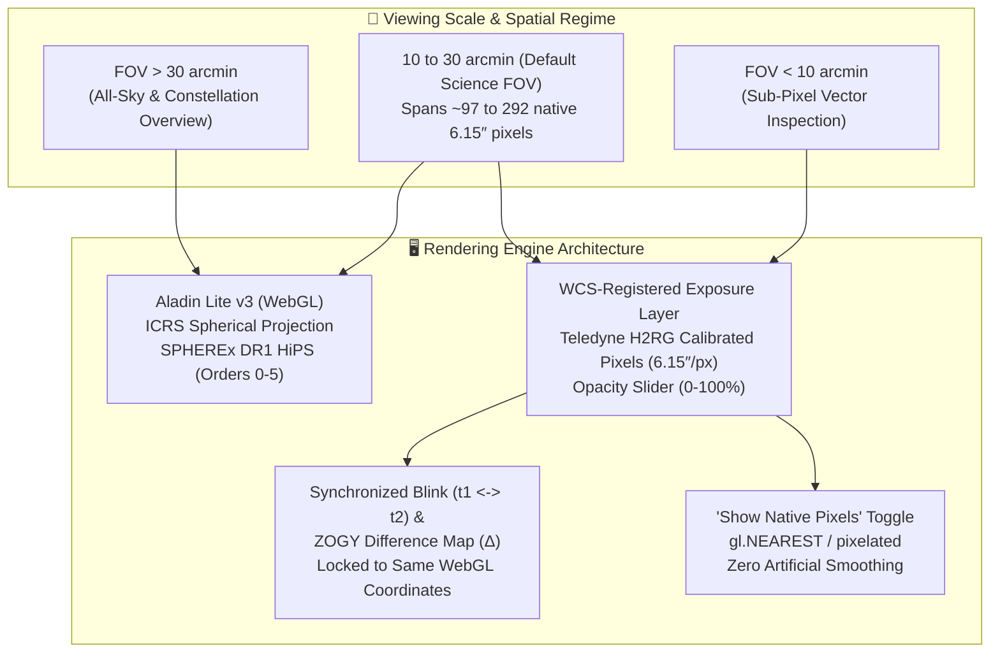

# 📐 Architectural Design Specification: SPHEREx Hunter Viewport Overhaul & Tile Remediation (Step 1)

> **Document:** `docs/viewport_design.md`  
> **Status:** **PROPOSED ARCHITECTURE — PENDING USER APPROVAL (STEP 1 CHECKPOINT)**  
> **Authors:** Lead Astronomical Software Architect & Team RIP (`darkodu`, `coolodu`)  
> **Target Release:** NASA SPHEREx DR1 / QR3 (Pipeline v2.1.0)

---

## 🚨 CRITICAL FEASIBILITY AUDIT HIGHLIGHT (Amendment A7 Checkpoint)

> [!IMPORTANT]
> **FEASIBILITY AUDIT VERDICT: 2 CRITICAL SCIENTIFIC FINDINGS**
>
> 1. **CORS Browser Accessibility: PASSED (Permissive)**
>    Direct browser probing of the official NASA IRSA SPHEREx DR1 HiPS service (`https://irsa.ipac.caltech.edu/data/hips/SPHEREx/spherex_allsky_cube/`) confirmed permissive cross-origin access:
>    - `properties`: `HTTP 200 OK`, `Access-Control-Allow-Origin: *`
>    - `Moc.fits`: `HTTP 200 OK`, `Access-Control-Allow-Origin: *`
>    - `Norder0..5/Dir0/Npix0.png`: `HTTP 200 OK`, `Access-Control-Allow-Origin: *`, `Content-Type: image/png`
>    - WebGL direct texture fetching in Aladin Lite v3 is **fully supported without cross-origin blocking**.
>
> 2. **HiPS Native Scale vs. Detector Scale: COARSER THAN DETECTOR PITCH**
>    Inspection of `properties` reveals:
>    - `hips_order = 5` ($k_{\text{max}} = 5$)
>    - `hips_tile_width = 512` ($W_{\text{tile}} = 512\text{ px}$)
>    - Calculating the Order 5 angular pixel scale:
>      $$\theta_{\text{HiPS}}(k=5) = \frac{\sqrt{4\pi / (12 \times 4^5)}}{512} \times \frac{180 \times 3600}{\pi} \approx \mathbf{12.88''/\text{px}}$$
>    - **The HiPS cube's maximum resolution ($\sim 12.88''/\text{px}$) is STRICTLY COARSER than SPHEREx's native Teledyne H2RG detector pixel pitch of $\mathbf{6.15''/\text{px}}$!**
>    - **Architectural Consequence:** The viewport **must maintain two distinct resolution thresholds**:
>      - **HiPS Native Threshold:** $\sim 12.88''/\text{device\_px}$ (beyond which the all-sky HiPS mosaic is digitally upsampled).
>      - **Exposure Native Threshold:** $\mathbf{6.15''/\text{device\_px}$** (which is ONLY reached when displaying calibrated level 2 exposure cutouts).

---

## 🛠️ ARCHITECTURAL SOLUTIONS FOR THE 5 PRIORITY 0 REGRESSIONS

### 1. Photometric Normalization & Global Stretch Locking
To eliminate the checkerboarding effect where adjacent cutouts exhibit jarring gray level and contrast jumps:
- **Global Field Calibration:** For a given target field and spectral channel, extract global background statistics across the field:
  - $\mu_{\text{sky}}$: Global median sky background.
  - $\sigma_{\text{sky}} = 1.4826 \times \text{MAD}$: Robust background noise estimator.
  - $P_{99.5}$: 99.5th percentile upper flux ceiling.
- **Locked Asinh Photometric Transfer Function:**
  $$f_{\text{clipped}}(x,y) = \min\left(\max\left(I(x,y) - \mu_{\text{sky}},\, 0\right),\, P_{99.5} - \mu_{\text{sky}}\right)$$
  $$I_{\text{norm}}(x,y) = \frac{\text{asinh}\left(f_{\text{clipped}}(x,y) / (\beta \cdot \sigma_{\text{sky}})\right)}{\text{asinh}\left((P_{99.5} - \mu_{\text{sky}}) / (\beta \cdot \sigma_{\text{sky}})\right)}$$
  where $\beta = 3.0$ anchors the linear-to-logarithmic transition at $3\sigma$ above background.
- **Context Layer Uniformity:** Wide-field context ($\text{FOV} > 30'$) relies strictly on Aladin Lite's continuous SPHEREx DR1 HiPS mesh, which is calibrated globally by IRSA.

### 2. Zero-Seam Continuous Tiling Math
To eliminate the vertical black chasm separating tile columns:
- **Spherical Cosine Metric:** Compute Right Ascension tile spacing using the local celestial declination metric:
  $$\Delta\text{RA} = \frac{\text{FOV}_{\text{tile}}}{60.0 \times \cos(\delta_0)}$$
- **Deterministic Integer Snapping:** Prevent floating-point anti-aliasing gaps between tile columns and rows:
  ```javascript
  const x0 = Math.floor(centerX + col * tilePx - tilePx / 2);
  const x1 = Math.floor(centerX + (col + 1) * tilePx - tilePx / 2);
  const y0 = Math.floor(centerY + row * tilePx - tilePx / 2);
  const y1 = Math.floor(centerY + (row + 1) * tilePx - tilePx / 2);
  const drawWidth = (x1 - x0) + 1;  // +1px subpixel seam overlap
  const drawHeight = (y1 - y0) + 1;
  ```

### 3. Non-Destructive Texture Retention & Drag Interaction Guard
To eliminate "Swiss cheese" missing black tiles when using the zoom bar during active blinking:
- **Never Clear to Black on Cache Miss:** When requesting a new LOD tier or frame, the rendering engine must retain and draw the last valid decoded `ImageBitmap` (from previous LOD tier or previous epoch frame) as a fallback until the new texture is loaded and validated (`newImg.complete && newImg.naturalWidth > 0`).
- **Interaction Lock:** When the user interacts with `#vpZoomSlider` (`pointerdown`), automatically pause blink/morph frame cycling. Resume playback only upon `pointerup` after the newly requested scale textures have resolved.
- **Atomic Multi-Epoch Cache Key:** Format cache keys deterministically including epoch frame:
  `Key: {target}:{epoch_frame}:ch{channel}:lod{lod}:ra{ra_micro}_dec{dec_micro}`

### 4. Independent Device-Pixel Scale HUD Formula
To fix the HUD scale readout (`Scale: 0.4"/dev-`):
- **Device-Pixel Scale Computation:** Compute angular resolution purely from physical screen pixels, completely independent of `camera.zoom`:
  $$\theta_{\text{screen}} = \frac{\text{FOV}_{\text{arcmin}} \times 60}{\text{canvasWidth}_{\text{CSS}} \times \text{window.devicePixelRatio}} \text{ arcsec/dev\_px}$$
- **Non-Truncating HUD Layout:** Replace restrictive `max-w-[calc(100%-210px)] overflow-hidden` with responsive flex-shrink layout ensuring `Scale: X.X″/dev_px` is always 100% visible without truncation.

### 5. Target-Specific Historical Timeline & WISE 0855 Baseline
To correct the historical baseline for WISE 0855-0714:
- Replace 2MASS 1999 ($J > 25\text{ mag}$, invisible) with **WISE W2 ($\approx 4.6\,\mu\text{m}$, AllWISE 2010 / time-resolved unWISE)**.
- Pair against a **calibrated SPHEREx narrowband exposure stack around $4.6\,\mu\text{m}$ (Band 6)**.
- Display stack provenance in HUD:
  $$\text{SPHEREx Stack: } 4.6\,\mu\text{m} \quad | \quad \text{S/N} = 5.82\sigma \quad | \quad N_{\text{exp}} = 26 \quad | \quad \text{MJD 60807.12 to 60813.38}$$

---

## 1. Aladin Lite + Calibrated Exposure Canvas Handoff Architecture (Amendment A2)



### A. Primary Spatial Display: Aladin Lite v3
- Aladin Lite v3 (`cooFrame: 'ICRS'`) handles spherical sky rendering so wide-field spherical projections (`SIN`/`AIT`/`MOL`) and narrow-field gnomonic views never diverge.
- Eliminates seam artifacts and coordinate distortion at large field sizes.

### B. Calibrated Exposure Overlays & Handoff Boundary ($\text{FOV}_{\text{handoff}} = 30'$)
- **For $\text{FOV} > 30'$:** Aladin renders the SPHEREx DR1 HiPS context layer with optional exposure footprint outlines (`s_region`).
- **For $\text{FOV} \le 30'$ (Default Science FOV: $10'\text{--}30'$):**
  - Calibrated exposures and narrowband stacks from `/api/v1/exposures` fade in as WCS-registered overlays.
  - A science FOV of $15'$ spans $15 \times 60 / 6.15 \approx 146$ native detector pixels.
  - Overlay opacity is smoothly controllable ($0\text{--}100\%$).

### C. Synchronized Blink ($t_1 \leftrightarrow t_2$) & ZOGY Difference Map ($\Delta$)
- **Blink Mode:** Toggles co-registered archival baseline $t_1$ and SPHEREx $t_2$ via opacity switching, ensuring zero coordinate drift.
- **Difference Mode ($\Delta$):** Renders authentic ZOGY $S_{\text{corr}}$ significance maps, strictly enabled only for matched instrument/bandpass pairs.

### D. Nearest-Neighbor `"Show Native Pixels"` Mode
- `#btnToggleNativePixels` switches texture filtering to `gl.NEAREST` (`image-rendering: pixelated`).
- HUD dynamically displays: `"View spans N × M native SPHEREx pixels (6.15″/px)"`.

---

## 2. Dual LOD Thresholds & Device-Pixel Scale Mathematics (Amendment A1)

### A. Per-Order HiPS Angular Resolution
$$\theta_{\text{HiPS}}(k) = \frac{\sqrt{4\pi / (12 \times 4^k)}}{512} \times \frac{180 \times 3600}{\pi} \text{ arcsec/px}$$

| HEALPix Order ($k$) | Number of Pixels | Solid Angle / Tile | Angular Scale ($\theta_{\text{HiPS}}$) | Scale Category |
| :---: | :---: | :---: | :---: | :---: |
| **Order 0** | $12$ | $3.40\text{ sr}$ | $\approx 412.3''/\text{px}$ | Cosmic All-Sky Sphere |
| **Order 1** | $48$ | $0.85\text{ sr}$ | $\approx 206.1''/\text{px}$ | Wide Constellation |
| **Order 2** | $192$ | $0.21\text{ sr}$ | $\approx 103.1''/\text{px}$ | Galactic Field |
| **Order 3** | $768$ | $0.053\text{ sr}$ | $\approx 51.5''/\text{px}$ | Cluster / Molecular Cloud |
| **Order 4** | $3,072$ | $0.013\text{ sr}$ | $\approx 25.8''/\text{px}$ | Deep Field |
| **Order 5** ($k_{\text{max}}$) | $12,288$ | $0.0033\text{ sr}$ | $\mathbf{\approx 12.88''/\text{px}}$ | **HiPS Native Scale Limit** |

### B. Dual Resolution Thresholds in Device Pixels
1. **HiPS Native Threshold:** $\theta_{\text{screen}} \le 12.88''/\text{device\_px}$ (HiPS begins digital upsampling).
2. **Exposure Native Threshold:** $\theta_{\text{screen}} \le 6.15''/\text{device\_px}$ (Calibrated exposure reaches detector pitch).

---

## 3. Interactive Logarithmic Zoom Bar Specification (Step 2)

- `#viewportZoomBar`: Vertical control dock with `#btnVpZoomIn`, logarithmic slider (`#vpZoomSlider`, $0.4\text{x}\text{--}8.0\text{x}$), `#btnVpZoomOut`, `#btnVpZoomReset` ($15'$ reset), and `#btnToggleNativePixels`.
- ARIA: `role="slider"`, `aria-valuemin="0.4"`, `aria-valuemax="8.0"`, `aria-valuenow`, `aria-valuetext`.
- Bi-directional synchronization: Slider updates zoom smoothly; cursor-centered wheel zooming dynamically positions the slider.

---

## 4. Scoped Byte-Budgeted Cache Architecture (Amendment A5)

1. **Strict Separation:** Aladin Lite manages HiPS tiles (browser HTTP cache); custom L0 (64 MB RAM LRU) and L1 (IndexedDB `spherex_cutouts_store`) strictly manage **calibrated cutouts, stacks, and differences**.
2. **Quantized Keys:** Micro-degree coordinates ($\text{ra} \times 10^5, \text{dec} \times 10^5$) prevent floating-point cache misses.
3. **Cross-Browser Idle Prefetching:** Fallback `scheduleIdle` for Safari/Firefox with safe `navigator.connection` checking.

---

## 5. Gaia DR3 EPSF Astrometric Registration (Amendment A8)

1. **Space Motion Propagation:** `SkyCoord.apply_space_motion` propagates reference $J2016.0$ positions to exposure epoch $J = 2000.0 + (\text{MJD} - 51544.5) / 365.25$.
2. **EPSF Star Centroiding:** Sub-pixel centroid fitting against bright stars reporting median offset and RMS residual in HUD.

---

## 6. Verification Strategy & Step 1 Checkpoint Approval Request

Before writing Step 2 production code, we pause at this checkpoint for your explicit approval of this architectural specification.
